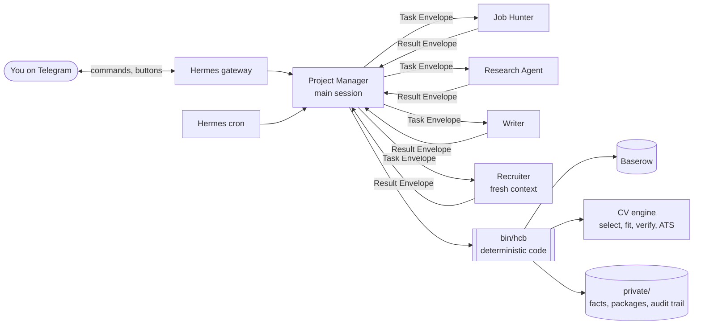

# Hermes Career Buddy

[](../../actions/workflows/ci.yml)
[](LICENSE)

**A personal multi-agent job-search assistant, run from Telegram, that finds roles, prepares tailored
CVs from verified evidence and reviews them like a recruiter, and never applies or contacts anyone on
its own.**

Directed by Juan Munoz (Industrial Engineer) and built on [Hermes Agent](https://github.com/NousResearch/hermes-agent)
as a portfolio project in human-centred AI automation: agents do the searching, drafting and checking;
deterministic code enforces the rules; the person makes every decision.

## Why this exists

After a successful visa process I arrived in Tasmania with a clear goal: an engineering role in my own field,
where I can grow my professional experience and contribute to the community I now live in. That field is
small here. The right roles are few, they appear on many different boards and employer pages, and each one
deserves an application written for it, not a generic CV.

So this is not a general job search engine that points at everything. It is a narrow one, designed around my
target roles, my region, my verified experience and the way I like to work. It looks only where those roles
appear, discards what would not move my career forward, and prepares documents I can stand behind.

That is also the idea I want to explore beyond my own job search. Many people and businesses pay for large
general-purpose software and never get its full value, because it was not shaped around their needs or it
is hard to understand. With today's AI tools we can afford to build the opposite: small systems customised
to one person's or one team's workflow, that they actually use every day, with the human still making
the decisions.

## What it does

| When | What happens | Where you see it |
|---|---|---|
| Mon-Fri 07:30 / 12:30 / 16:30 | The **Job Hunter** sweeps approved job boards, employer pages and the job-alert e-mails (read-only mailbox, links never opened), skips what it has seen, discards out-of-scope titles, ranks the rest by alignment with the target roles | Telegram: **Top 3** with a *Prepare Docs* button, then the other offers best to worst (silent when nothing is new) |
| On a button tap | The **Writer** builds a CV and cover letter from the fact bank only; the **Recruiter** reviews them in a separate context (up to 3 rounds, deterministic verdict gates) | The package as PDFs in Telegram for the user to review; by e-mail (all PDFs, only to the user's own address) only after he writes «Correo <ID>» |
| Friday 18:00 | The **Research Agent** reviews the local market; the PM closes expired offers and flags follow-ups | Input for Saturday |
| Saturday 08:00 | Weekly report (max 3 pages) | PDF by e-mail, notice in Telegram |
| Daily 03:00 | Encrypted backup of the private data and the database, verified before old copies are pruned | Local archive |

Offers that only exist on SEEK, LinkedIn or Indeed are never scraped: the system marks them 📎 and asks the
user for the ad (a PDF or the pasted text) before preparing documents.

## Results so far (first 10 days of real use, Nov 2026)

- **287 job postings screened** from approved boards, employer pages and alert e-mails; out-of-scope ones
  logged with the rule that discarded them.
- **16 daily digests** delivered to Telegram, **26 document versions** for 8 applications, each reviewed by the
  Recruiter agent before reaching the user.
- **51 recorded approvals**: every configuration, source or rule change has a written trail.
- **210+ automated tests** covering the rules, the integrations and the security limits.

Every application is stored in **Baserow** (applications, documents, networking contacts), the
system's own source of truth.

## Architecture



- **One PM, four specialists.** The PM is the user-facing session; specialists are Hermes subagents that
  load their own skill and return a JSON Result Envelope the PM validates.
- **LLMs judge, code decides.** Thresholds, ranking, idempotency, approval gates, Recruiter verdicts,
  page counts and every Baserow write are Python in `hcb/`, covered by tests.
- **Facts are the only source.** CVs are assembled from a verified fact bank; `verify.py` fails any
  claim, figure or tool that is not in it, and every summary claim must be proven further down the CV.

## Design principles

- **Human in the loop by construction.** The system prepares; the person submits. Nothing submits an
  application or contacts a third party, under any setting.
- **Approval gates.** Configuration, source and rule changes go through written proposals
  (`docs/proposals/`) and recorded approvals.
- **Untrusted content stays data.** Job ads and web pages are never treated as instructions.
- **Least privilege.** The database token can create and update, never delete; secrets live outside the
  repository; buttons only act for the allowlisted Telegram account.
- **Public code, private data.** Everything personal lives in `private/` (git-ignored). A privacy scanner
  blocks any personal value from a commit (`.githooks/pre-commit`) and runs in CI.

## Try it with the synthetic persona

The repository ships a fictional candidate (Alex Example) in `examples/candidate/`, so it runs end to
end without anyone's real data:

```bash
pip install pyyaml ruamel.yaml
export HCB_PRIVATE_DIR="$PWD/examples/candidate"
python3 -B -m unittest discover -s tests -t .      # unit, contract, security and privacy tests
bin/hcb doctor                                     # checks the installation
(cd engine/build && npm ci) && bash engine/build/selftest.sh   # CV engine self-test
```

Running the agents themselves needs Hermes Agent, a Telegram bot and a Baserow instance:
see [docs/RUNBOOK.md](docs/RUNBOOK.md) and [docs/DEPLOYMENT.md](docs/DEPLOYMENT.md).

## Stack

Hermes Agent (agents, skills, cron, Telegram gateway, plugin) · Python 3 (rules, envelopes, Baserow
adapter, privacy scan) · Node.js (CV rendering to HTML/PDF/DOCX) · Baserow in Docker · Telegram Bot API ·
OpenSSL (backups).

## Documentation

- [docs/STATUS.md](docs/STATUS.md): every capability as Specified / Implemented / Validated, and the change log
- [docs/ARCHITECTURE.md](docs/ARCHITECTURE.md): how the specification maps onto Hermes, alternatives rejected
- [docs/proposals/](docs/proposals/): design proposals and decisions (P-1 to P-10)
- [knowledge/specs/](knowledge/specs/): the role specifications (Spanish)

## Technical details

## How Hermes loads this project

1. **Project root = this folder** (it is a git repository; Hermes resolves the project root to the
   nearest `.git`). Start Hermes with this folder as the working directory / workspace.
2. **Project context:** Hermes loads exactly one context file, first match wins
   (`.hermes.md` → `AGENTS.md` → `CLAUDE.md`). It loads **`AGENTS.md`**: PM identity, authorities,
   approval gates, untrusted-content rule, project map. `CLAUDE.md` only points to it for Claude Code.
3. **Project skills:** `.hermes/skills/career-buddy/*/SKILL.md`. Hermes indexes them as `[project]`
   skills (highest precedence) because this folder was trusted once with
   `hermes skills trust "<this folder>"`. Each skill is scanned by Hermes' skills-guard on load.
   Full skill bodies load on demand via `skill_view` (progressive disclosure), so the base
   prompt stays small.
4. **Roles:** the normal session is the PM. Specialists run as `delegate_task` subagents: the PM
   builds a Task Envelope with `bin/hcb task make`, the child receives `AGENTS.md` automatically,
   loads its role skill and returns a JSON Result Envelope that the PM validates with
   `bin/hcb task validate`.
5. **Deterministic tools:** agents call `bin/hcb ...` through the terminal tool for everything the
   spec says must be code (thresholds, classification, Top 5, number map, follow-ups, Recruiter
   verdict gates, idempotency, approvals, page counts, Baserow, A-H, Engine pipeline).
6. **Knowledge:** the candidate's facts live in `private/facts/` and the CV method in `engine/`
   (copied from the earlier Job Application Engine; both fingerprinted around every run). Specs are
   controlled copies in `knowledge/specs/` (see `knowledge/SOURCES.md`).
7. **Scheduling:** Hermes cron jobs (profile `career-buddy`) with `--workdir` set to this folder load the
   same context and trusted skills (`config/schedules.yaml`).

## Folder tree

```
Hermes Career Buddy/
├── AGENTS.md                         Project context (PM identity + shared rules) loaded by Hermes
├── CLAUDE.md                         Pointer for Claude Code (Hermes ignores it: AGENTS.md wins)
├── README.md
├── .hermes/skills/career-buddy/      Project skills (Hermes-native)
│   ├── hcb-project-manager/          Orchestration, commands, delegation, gates, report, interview
│   ├── hcb-job-hunter/               Discovery, verification, 8579, A-H, classification, Baserow
│   ├── hcb-research-agent/           Friday market review, interview research dossier
│   ├── hcb-writer/ (+references/)    Tailored CV / cover letter through the Engine pipeline
│   ├── hcb-recruiter/ (+references/) Hiring review rounds 1-3, interview brief + voice simulation
│   └── candidate-writing-voice/      Voice layer (controlled copy v1.0.0, live decisions.md)
├── bin/hcb                           CLI wrapper (selects the Hermes venv python)
├── hcb/                              Deterministic code
│   ├── rules.py                      Alignment ranking (P-4 B) / legacy fit > 50, C1-C11, Top 5, exploratory, number map, follow-up, lifecycle
│   ├── commands.py                   Spanish command vocabulary + report-number resolution
│   ├── envelopes.py                  Task / Result Envelopes, idempotency keys, contract validation
│   ├── state.py                      Events, approvals, idempotency ledger, task records
│   ├── baserow.py                    Baserow adapter (create/update only, idempotent, read-back)
│   ├── ah_adapter.py                 Wraps the existing A-H evaluator (no reimplementation)
│   ├── engine.py                     Runs the Engine's build/verify scripts; versioned folders
│   ├── recruiter_gates.py            Deterministic verdict G1-G5, language guard, round limit
│   ├── report.py                     Weekly report HTML/PDF, number map, 3-page check
│   └── cli.py, util.py
├── engine/                           CV method (rules/) + build, render and verification scripts (build/)
├── config/                           system.yaml, baserow-mapping.yaml, sources.yaml, schedules.yaml
├── knowledge/                        SOURCES.md, specs/ (6 approved specs)
├── docs/                             STATUS.md, ARCHITECTURE.md, RUNBOOK.md, proposals/
├── tests/                            Unit, contract, security and privacy tests; synthetic fixtures/
├── examples/candidate/               Synthetic persona (public demo)
└── private/                          Personal zone, git-ignored: facts/, voice/, applications/,
                                      reports/, state/, test-evidence/, ah-evaluator/, knowledge/kb/
```

## Where each capability lives

| Capability | Instructions | Code / config | Evidence |
|---|---|---|---|
| Project Manager orchestration | `AGENTS.md`, `hcb-project-manager` | `envelopes.py`, `state.py`, `commands.py` | RT-01, RT-02 |
| Job discovery and evaluation | `hcb-job-hunter` | `rules.py`, `ah_adapter.py`, `config/sources.yaml` | unit tests, A-H contract test |
| Tasmania market and company research | `hcb-research-agent` | `knowledge/kb/` | specified only |
| Tailored CV and cover letter | `hcb-writer` | `engine.py` + Engine scripts | pipeline replay, RT-02 |
| Candidate Writing Voice | `candidate-writing-voice` | — | indexed in RT-01 |
| Recruiter review | `hcb-recruiter` | `recruiter_gates.py` | gate tests, RT-02 |
| Baserow | `hcb-job-hunter`, PM | `baserow.py`, `config/baserow-mapping.yaml` | RT-03 (live read, dry-run) |
| Telegram | PM skill, plugin `career-buddy-buttons` | `daily.py`, `telegram_api.py`, `prepare_request.py` | live tests passed |
| Weekly report and tracking | PM skill §D/F | `report.py`, `rules.followups_due` | report test |
| Interview preparation | PM §E, `hcb-recruiter` Flow B, `hcb-research-agent` | — | specified only |

## Safety switches
`config/system.yaml → features` holds every external switch (Baserow writes, Telegram delivery, scheduled jobs,
web discovery, contact research); `docs/STATUS.md` records when and why each one changed. Only the approved
sources in `config/sources.yaml` are read. Nothing in this project submits applications or contacts third
parties, under any setting.

## License

[MIT](LICENSE)
